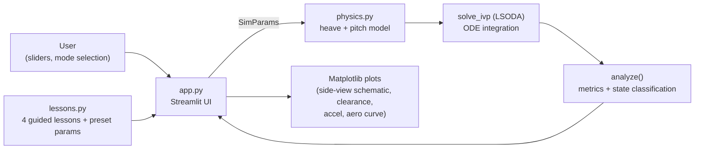

# 🐬 F1 Porpoising Teaching Lab

[](LICENSE)
[](https://www.python.org/)
[](https://streamlit.io/)

An interactive Streamlit teaching app for exploring **porpoising** — the high-speed bouncing
phenomenon seen in modern ground-effect Formula 1 cars — by changing live parameters. A dark
"graphite / neon" themed UI demonstrates the core elements of real F1 ground-effect physics
(heave + pitch dynamics, a "peak + stall" aero curve, and flow lag) through a didactic model.

> 🇹🇷 Türkçe sürüm: [README.md](README.md)

---

## 📸 Demo

Since this is a Streamlit app, a static screenshot only captures a fraction of the experience
(sliders, the live animation, and the trajectory traced on the aero curve are all interactive).

https://f1-porpoising-teaching-lab.streamlit.app

---

## 🧠 What is "porpoising"?

Modern F1 cars generate massive downforce from air flowing extremely close to the ground
(ground effect). As ride height drops, downforce increases — but below a certain threshold the
flow separates and downforce **suddenly collapses** (stall). When the car drops, the springs push
it back up, the flow reattaches, downforce returns, and the car is pulled back down. The flow's
reaction lag pumps energy into this cycle like a "negative damping" term — the result is a
characteristic ~5 Hz bounce (a limit cycle) that fatigues both driver and floor.

This lab shows this mechanism with a simplified but physically consistent model: change speed,
aero force, damping and road input with sliders and watch the result instantly.

---

## 🏗️ Architecture



* **`app.py`** — Streamlit UI: builds `SimParams` from sidebar sliders, caches the simulation
  with `st.cache_data`, renders KPI cards + Matplotlib plots.
* **`physics.py`** — physics core: integrates the state vector forward in time with
  `scipy.integrate.solve_ivp` (LSODA), reduces the result to numeric metrics via `analyze()`
  (peak acceleration, oscillation frequency, stall fraction, state label).
* **`lessons.py`** — the text and preset parameter set for each of the 4 "Guided Lesson" steps
  (merged with `DEFAULTS`).

---

## 🔬 Physics model

State vector: `y = [z, θ, ż, θ̇, L_f, L_r]` — heave (CG vertical displacement), pitch (nose
angle), their rates, and the lagged front/rear downforce.

| Quantity | Expression |
|---|---|
| Ride height | `h_f = h0_f + z + a·θ − u_f`, `h_r = h0_r + z − b·θ − u_r` (rear axle sees the same profile delayed by wheelbase) |
| Dynamics | `m·z̈ = F_f + F_r − L_f − L_r`,  `I_y·θ̈ = a(F_f − L_f) − b(F_r − L_r)` |
| Aero curve | `L(h) = ½ρV²·ClA·mult·g(h)`, `g` = two half-gaussians: wide on the high side (decays toward a `baseline`), narrow and sharp on the low side (stall) |
| Attachment-loss threshold | `h_att = h_pk − w_lo` (the steepest-drop point of the curve) |
| Flow lag | `τ·L̇ = L_static(h, V) − L` — in the stall region this lag acts like **negative damping**, feeding porpoising |
| Ground contact | Progressive "bump stop" force (below `h_min`) |
| Driver lift | At `t_lift`, speed ramps down at `decel` toward `V_lift` (downforce drops with V², damping the oscillation) |

The model is **didactic**; it is not a calibration of any real car, but the resulting behavior
(frequency, amplitude order of magnitude, threshold speed) is in line with real F1 observations.

---

## 📁 Code structure

| File | Content |
|---|---|
| `app.py` | Streamlit UI — dark graphite/neon theme, sliders, animated side-view schematic, KPI cards, plots |
| `physics.py` | Heave + pitch model, peak+stall aero curve with flow lag, `solve_ivp` (LSODA), `analyze()` metrics |
| `lessons.py` | Text for 4 guided lesson steps + each step's preset parameter set |
| `.streamlit/config.toml` | Dark theme configuration |
| `requirements.txt` | Dependencies: `streamlit`, `scipy`, `numpy`, `matplotlib` |

---

## ⚙️ Setup and running

```bash
pip install -r requirements.txt
streamlit run app.py          # run from inside the porpoising_lab folder
python physics.py             # physics only: a speed sweep (static validation, in the terminal)
```

Developed and tested with Python 3.11; expected to work on any modern Python 3.9+ environment.

---

## 🎓 Guided lessons (4 steps)

The app's "Guided Lesson" mode has 4 steps, each loading a preset parameter set:

1. **⚖️ Equilibrium** — How springs and downforce reach balance (40 m/s, small bump → damped response)
2. **🌬️ Airflow effect** — Downforce's dependence on ride height: the peak and stall curve (75 m/s, operating point approaches the stall threshold)
3. **🛣️ Road bump excitation** — A periodic road input coinciding with body resonance causes forced vibration (60 m/s, λ=14 m → ~4.3 Hz)
4. **🐬 The porpoising cycle** — Stall → lift → reattachment → collapse again: a full limit-cycle demonstration, recovered via driver lift (85 m/s)

---

## ✅ Validation findings

A speed sweep with the default vehicle parameters (`physics.VehicleParams`):

| Cruise speed V | Behavior |
|---|---|
| ≤ 75 m/s | Damped — the bump response dies out within a few oscillations |
| ~80 m/s | Sustained small-amplitude oscillation (marginal) |
| ≥ 85 m/s | Growing oscillation → **limit cycle** (~5 Hz, ~1.3 g peak vertical acceleration) |
| 85 m/s + 2.0× damping | Porpoising suppressed — sufficient damping can overcome the aero feed |

These values can be reproduced by running `python physics.py` in a terminal.

---

## 📚 References

| Topic | Source |
|---|---|
| Ground-effect aerodynamics, the porpoising mechanism | FIA technical regulations and general 2022-season porpoising discussion literature |
| Heave/pitch rigid-body suspension model | Classic half-car suspension modeling approach |
| Numerical ODE integration | `scipy.integrate.solve_ivp`, LSODA method |
| UI | [Streamlit](https://streamlit.io/) documentation |

---

## 🙏 Inspiration / Attribution

This project was independently written from scratch, inspired by the "F1 Porpoising Teaching Lab"
concept shared by the Instagram account **[@veer.alak.sim](https://www.instagram.com/veer.alak.sim/)**.

---

## 📄 License

[MIT](LICENSE) © 2026 Musa Buğra Demir
