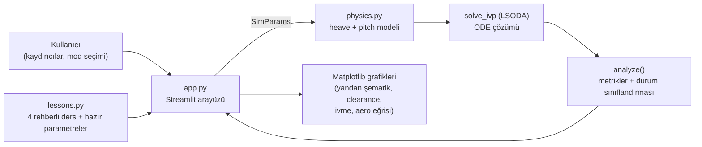

# 🐬 F1 Porpoising Teaching Lab

[](LICENSE)
[](https://www.python.org/)
[](https://streamlit.io/)

Ground-effect kaynaklı **porpoising** (F1 araçlarının yüksek hızda zıplaması) fenomenini
canlı parametrelerle keşfetmek için hazırlanmış interaktif Streamlit öğretim uygulaması.
Koyu "graphite / neon" temalı arayüz; heave + pitch dinamiği, "tepe + stall" aero eğrisi ve
akış gecikmesi gibi gerçek F1 ground-effect fiziğinin temel unsurlarını didaktik bir modelle gösterir.

> 🇬🇧 English version: [README.en.md](README.en.md)

---

## 📸 Demo

Bu bir Streamlit uygulaması olduğundan statik bir ekran görüntüsü deneyimin yalnızca küçük bir
kısmını yansıtır (kaydırıcılar, canlı animasyon, aero eğrisi üzerindeki yörünge gibi etkileşimli
unsurlar statikte kaybolur).

https://f1-porpoising-teaching-lab.streamlit.app

---

## 🧠 Nedir bu "porpoising"?

Modern F1 araçları, zemine çok yakın akan hava sayesinde (ground effect) büyük downforce üretir.
Ride height (yerden yükseklik) düştükçe downforce artar — ama belirli bir eşiğin altında akış
ayrılır ve downforce **aniden çöker** (stall). Araç çöktüğünde yaylar onu yukarı iter, akış yeniden
tutunur, downforce geri gelir ve araç tekrar aşağı çekilir. Akışın tepki gecikmesi bu döngüye enerji
pompalayan bir "negatif sönüm" gibi davranır — sonuç, sürücüyü ve zemini yoran, karakteristik
~5 Hz'lik bir zıplama (limit çevrimi) olur.

Bu laboratuvar, bu mekanizmayı sadeleştirilmiş ama fiziksel olarak tutarlı bir modelle gösterir:
hız, aero kuvvet, sönüm ve yol girdisini kaydırıcılarla değiştirip sonucu anında gözlemleyebilirsiniz.

---

## 🏗️ Mimari



* **`app.py`** — Streamlit arayüzü: kenar çubuğundaki kaydırıcılardan `SimParams` oluşturur,
  simülasyonu `st.cache_data` ile önbellekler, sonuçları KPI kartları + Matplotlib grafikleriyle çizer.
* **`physics.py`** — fizik çekirdeği: durum vektörünü `scipy.integrate.solve_ivp` (LSODA) ile
  zamanda ileri sarar, sonucu `analyze()` ile sayısal metriklere (pik ivme, salınım frekansı,
  stall süresi, durum etiketi) indirger.
* **`lessons.py`** — "Rehberli Ders" modundaki 4 adımın metinleri ve her adıma özel hazır
  parametre setleri (`DEFAULTS` ile birleştirilir).

---

## 🔬 Fizik modeli

Durum vektörü: `y = [z, θ, ż, θ̇, L_f, L_r]` — heave (CG dikey yer değiştirmesi), pitch
(burun açısı), hızları, ve gecikmeli ön/arka downforce.

| Büyüklük | İfade |
|---|---|
| Ride height | `h_f = h0_f + z + a·θ − u_f`, `h_r = h0_r + z − b·θ − u_r` (arka aks, yolu dingil mesafesi kadar geç görür) |
| Hareket | `m·z̈ = F_f + F_r − L_f − L_r`,  `I_y·θ̈ = a(F_f − L_f) − b(F_r − L_r)` |
| Aero eğrisi | `L(h) = ½ρV²·ClA·mult·g(h)`, `g` = iki yarı-gauss: yüksek tarafta geniş (taban `baseline`'a düşer), alçak tarafta dar ve keskin (stall) |
| Attachment-loss eşiği | `h_att = h_pk − w_lo` (eğrinin en dik düşüş noktası) |
| Akış gecikmesi | `τ·L̇ = L_statik(h, V) − L` — stall bölgesinde bu gecikme **negatif sönüm** gibi davranır ve porpoising'i besler |
| Zemin teması | Progresif "bump stop" kuvveti (`h_min` altında) |
| Sürücü lift | `t_lift` anında hız, `decel` ivmesiyle `V_lift` hedefine düşer (downforce V² ile düşer, salınım söner) |

Model **didaktiktir**; gerçek bir aracın kalibrasyonu değildir, ama ortaya çıkan davranış
(frekans, genlik mertebesi, eşik hız) gerçek F1 gözlemleriyle aynı mertebededir.

---

## 📁 Kod yapısı

| Dosya | İçerik |
|---|---|
| `app.py` | Streamlit arayüzü — koyu graphite/neon tema, kaydırıcılar, animasyonlu yandan şematik, KPI kartları, grafikler |
| `physics.py` | Heave + pitch modeli, tepe+stall aero eğrisi (akış gecikmeli), `solve_ivp` (LSODA), `analyze()` metrikleri |
| `lessons.py` | 4 adımlı rehberli ders metinleri + her adımın hazır parametre seti |
| `.streamlit/config.toml` | Koyu tema ayarı |
| `requirements.txt` | Bağımlılıklar: `streamlit`, `scipy`, `numpy`, `matplotlib` |

---

## ⚙️ Kurulum ve çalıştırma

```bash
pip install -r requirements.txt
streamlit run app.py          # porpoising_lab klasöründen çalıştırın
python physics.py             # sadece fizik: hız taraması (statik doğrulama, terminalde)
```

Python 3.11 ile geliştirilip test edilmiştir; modern bir Python 3.9+ ortamında da çalışması beklenir.

---

## 🎓 Rehberli ders (4 adım)

Arayüzdeki "Rehberli Ders" modu, her biri hazır bir parametre setiyle gelen 4 adımdan oluşur:

1. **⚖️ Denge** — Yaylar ve downforce nasıl dengeye gelir? (40 m/s, küçük tümsek → sönümlü tepki)
2. **🌬️ Hava akışı etkisi** — Downforce'un ride height'a bağımlılığı: tepe ve stall eğrisi (75 m/s, çalışma noktası stall eşiğine yaklaşır)
3. **🛣️ Yol tümseği tahriki** — Periyodik yol girdisi gövde rezonansıyla çakışırsa zorlanmış titreşim oluşur (60 m/s, λ=14 m → ~4.3 Hz)
4. **🐬 Porpoising döngüsü** — Stall → kaldırma → yeniden tutunma → tekrar çökme: tam limit-çevrimi davranışı ve driver lift ile kurtarma (85 m/s)

---

## ✅ Doğrulama bulguları

Varsayılan araç parametreleriyle (`physics.VehicleParams`) yapılan hız taraması:

| Seyir hızı V | Davranış |
|---|---|
| ≤ 75 m/s | Sönümlü — tümsek tepkisi birkaç salınımda söner |
| ~80 m/s | Sürdürülen küçük genlikli salınım (sınırda) |
| ≥ 85 m/s | Büyüyen salınım → **limit çevrimi** (~5 Hz, ~1.3 g pik dikey ivme) |
| 85 m/s + sönüm ×2.0 | Porpoising bastırılır — yeterli sönüm aero beslemeyi yenebilir |

Bu değerler `python physics.py` çalıştırılarak terminalde tekrar üretilebilir.

---

## 📚 Kaynakça / Referanslar

| Konu | Kaynak |
|---|---|
| Ground-effect aerodinamiği, porpoising mekanizması | FIA teknik düzenlemeleri ve 2022 sezonu porpoising tartışmaları (genel literatür) |
| Heave/pitch rijit gövde süspansiyon modeli | Klasik yarım-araç (half-car) süspansiyon modelleme yaklaşımı |
| Sayısal ODE çözümü | `scipy.integrate.solve_ivp`, LSODA yöntemi |
| Arayüz | [Streamlit](https://streamlit.io/) dokümantasyonu |

---

## 🙏 Esin kaynağı / Attribution

Bu proje, Instagram'daki **[@veer.alak.sim](https://www.instagram.com/veer.alak.sim/)** hesabının
paylaştığı "F1 Porpoising Teaching Lab" konseptinden esinlenerek, sıfırdan yazılmış bağımsız bir
uygulamadır.

---

## 📄 Lisans

[MIT](LICENSE) © 2026 Musa Buğra Demir
